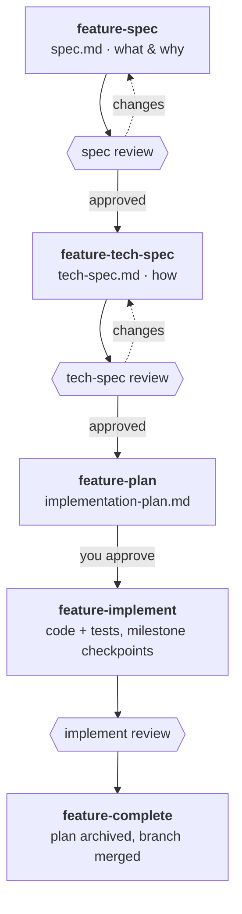
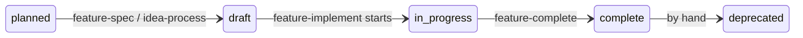

# The feature lifecycle

Every feature in myspec moves through the same stages. Each stage is a skill, each produces a document in `${aiDir}/features/<feature>/`, and each ends at a gate where you approve or send it back. This page maps the stages, the side paths, and what runs in the background.

## The main path

| Stage | Skill | Writes | Gate |
|-------|-------|--------|------|
| Specify | `/myspec:feature-spec` | `spec.md`, `dependencies.md`, manifest entry | Your answers to its questions |
| Review the spec | `/myspec:feature-spec-review` | Findings; spec `status: approved` | No Critical or High findings, and your confirmation |
| Design | `/myspec:feature-tech-spec` | `tech-spec.md` | Your approval of the draft |
| Review the design | `/myspec:feature-tech-spec-review` | Findings; tech spec `status: approved` | Same as the spec review |
| Plan | `/myspec:feature-plan` | `implementation-plan.md` | Your approval of the plan |
| Implement | `/myspec:feature-implement` | Code, tests, per-phase reviews | Each milestone checkpoint |
| Check conformance | `/myspec:feature-implement-review` | `conformance-report.md` | You route each finding |
| Complete | `/myspec:feature-complete` | Archived plan, `CHANGELOG.md` entry | Merge or PR confirmation |

Reviews run in a fresh subagent that gets only the file paths, so the reviewer has not seen the conversation that produced the document. For bugs in the diff itself, use Claude Code's built-in `/code-review` before completing.

## Two kinds of status

myspec tracks two things, and keeps them apart.

**Document status** sits in each document's frontmatter and says whether you can trust it: `draft` → `approved` (set by a review) → `deprecated`. Changing an approved feature with `feature-update` puts it back to `draft`.

**Feature status** sits in `${aiDir}/features/index.yaml` and says how far the work has got:

Progress comes only from the checkboxes in `implementation-plan.md`, never from reading the code.

## Side paths

Not every feature starts at a blank spec or follows the straight line.

| Situation | Path |
|-----------|------|
| Just an idea, not ready to spec | `brainstorm` → `idea-intake` (queues and prioritizes it) → `idea-process` (turns it into a spec) |
| Code exists, no docs | `feature-discover` writes `discovery.md`, and optionally the spec and tech spec, from the code |
| Feature too big for one tech spec | `feature-decompose` splits it into sub-features, each with its own lifecycle |
| UI-heavy feature | `feature-mockup` → `feature-mockup-review` between the spec and the tech spec, to check the spec visually |
| Spec may clash with another feature | `cross-spec-validation` after the spec is approved |
| Changing a shipped feature | `feature-update` edits the spec and tech spec in place → `feature-plan` → `feature-implement` → `feature-complete` |
| Docs drifted from the code | `feature-spec-sync` updates the docs; `feature-verify` audits one feature |
| Bug fix or small tweak | No pipeline. Ask for the change; the hooks still apply |

## What runs in the background

These hooks run from the plugin on every session, whichever skill you are in.

- **Work isolation.** Before the first source edit, you choose to develop in this checkout or in a worktree. The hooks block edits until you choose.
- **Stop gate.** When the agent has written code, it cannot finish its turn while your verification commands fail. You configure these in `.claude/verification.json`.
- **Frontmatter validation.** Every document under `${aiDir}/` keeps valid YAML frontmatter, so the manifest and the status checks can read it.
- **Session tracking and memory.** Each code session keeps a log. `/myspec:session-complete` archives it and proposes memories, such as procedures, facts and past incidents, that later sessions find with `memory-lookup` and `memory-preflight`.

## Fewer stops: autopilot

The pipeline asks for your approval a dozen times before any code exists, and you usually pick the recommended option. Say "autopilot" or pass `--autopilot`, and the review, validation, plan and implement gates take the recommended option and print each choice. Autopilot still stops on Critical findings, failing checkpoint probes, and anything outward-facing: push, PR, merge or deploy.

## See it end to end

[Full feature delivery](examples/flows/full-feature-delivery.md) follows one feature, Scheduled Exports, through all fourteen steps, showing what each skill asked and wrote.
