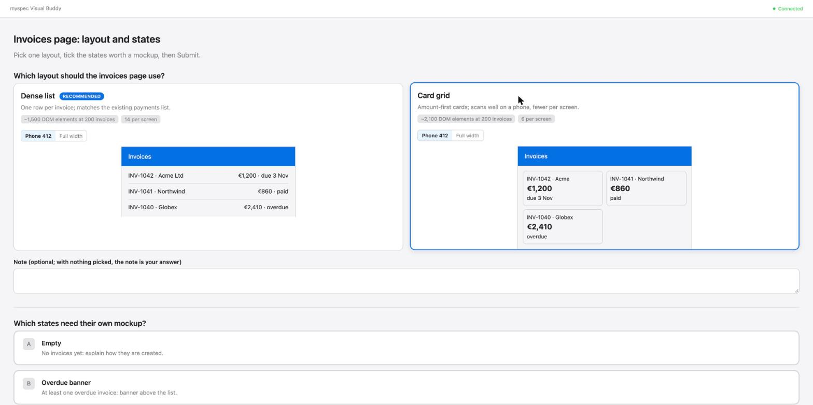
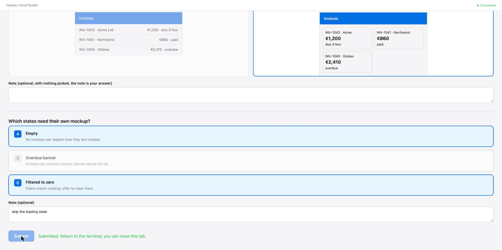
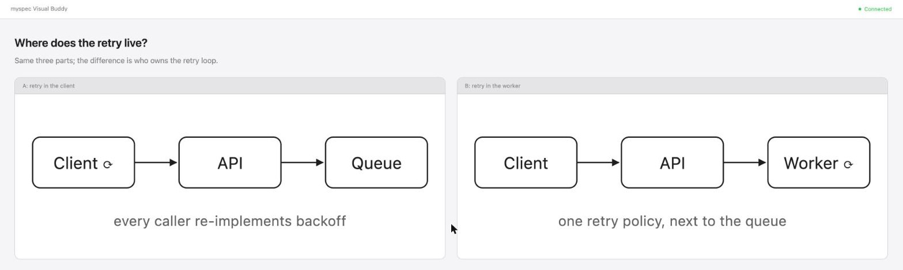
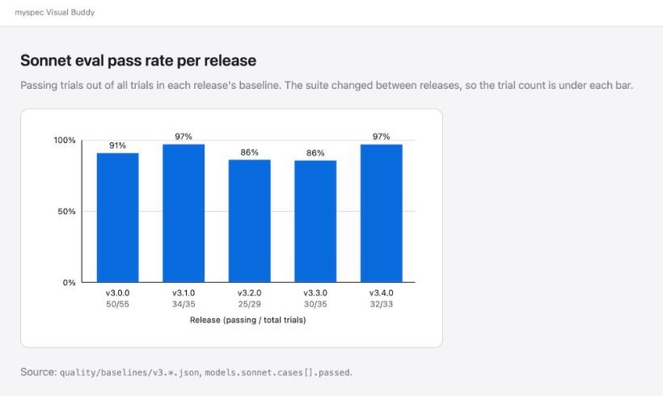
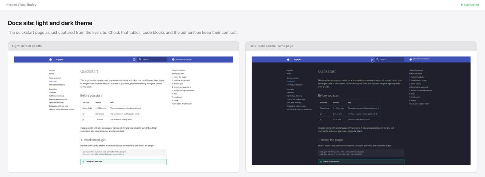

# Visual Buddy

Visual Buddy is a browser tab that sits beside your Claude Code conversation. When something is easier to see than to read, the agent shows it there. That might be two layouts side by side, an architecture diagram, a graph of measurements, or the images an experiment just rendered. You look, click or press Submit, and keep talking in the terminal. The conversation stays in the terminal, and the pictures go in Visual Buddy.

It runs locally as a small Node server that ships with the plugin and needs no dependencies. Nothing leaves your machine, and it opens only after you say yes.



## What it shows

| Use | You see | Comes from |
|---|---|---|
| Picking between options | Each option rendered side by side, a phone-width toggle, a note box, Submit | `/myspec:visualize-options`, the visual-questions setting, `feature-mockup`'s variant pick |
| Comparing designs | Two or three candidate architectures, data flows or state machines drawn next to each other | Options a skill proposes, with the visual-questions setting on |
| Explaining a structure | A diagram of a flow, sequence, state machine or entity relationships | `/myspec:brainstorm`, `visualize-options` show mode |
| Graphs | Bars or points drawn from real measurements, axes with units, the source named | `visualize-options` show mode, brainstorm |
| Results | The images, renders, charts or screenshots the agent just produced, or a before/after in a split | Brainstorm and any spike: *show, don't link* |
| Exploring | Mockups and wireframes you react to while ideas are still forming | `/myspec:brainstorm` |

The rule of thumb the agent follows is: would you understand this better by seeing it than by reading it? Requirements, scope, naming and trade-offs are words, so they stay in the terminal. A question *about* UI is not automatically visual. "What kind of wizard?" is a question in words, while "which of these wizard layouts?" needs a picture.

## Turning it on

There are two ways in.

- **Brainstorm offers it on its own.** In `/myspec:brainstorm`, the agent offers Visual Buddy the first time seeing would beat reading. That happens with options that look different, a structure that is easier to see than read, numbers whose shape matters, or a visual result the agent just produced. The offer comes as a message of its own. If you say no, the session stays text-only.
- **The project setting turns it on everywhere.** `/myspec:setup visual-questions` sets `visualQuestions` to `"auto"` in `.myspec.json` and installs `.claude/rules/visual-questions.md`. From the next session on, in every skill:
    - clearly visual questions are asked through `/myspec:visualize-options`;
    - partly visual questions get a last option, `Show in Visual Buddy`. When a reply lays out options, such as approaches or designs a skill proposes, it ends with one line offering to show them side by side;
    - diagrams, graphs and visual results go on screen when Visual Buddy is running, and are offered when it is not.

    `update` asks about this setting once per project. Switch it off the same way: `"off"` removes the rule.

Both need `node` on `PATH`. Visual Buddy costs tokens, because every option preview and every diagram is HTML the agent writes, which costs several times as much as a text answer.

## Examples

The screenshots below come from the 3.4.0 server. Each screen is a short HTML fragment the agent writes, and the server wraps it in the Visual Buddy frame.

### Pick a layout and the states to mock

While planning an invoices page, the agent has two questions: should the page be a list or cards, and which UI states deserve their own mockup? The layout question is visual, because an ASCII preview would misstate density, which is exactly what is being decided. So the agent runs `/myspec:visualize-options`, and both questions go on one screen.

Each layout card has a live preview with realistic rows, measured facts such as "~1,500 DOM elements at 200 invoices", and a **Phone 412 / Full width** toggle. In the screenshot at the top of this page, both previews are at phone width and Card grid is picked. The states question below it is a multi-select with its own note box:



Pressing **Submit** sends the answer straight back to the agent, in the same shape AskUserQuestion returns, so you never retype it:

```json
{
  "screen": "invoices-layout.html",
  "answers": {
    "Which layout should the invoices page use?": "Card grid",
    "Which states need their own mockup?": "Empty, Filtered to zero"
  },
  "annotations": {
    "Which states need their own mockup?": { "notes": "skip the loading state" }
  }
}
```

If you'd rather answer in the terminal ("cards, and only the empty state"), that works too. The agent maps your reply onto the same questions and does not ask you to go back and press Submit. Full walkthrough: [visualize-options examples](examples/skills/visualize-options.md).

### Compare two designs

Some designs differ in structure, and a diagram shows that difference faster than a paragraph. Here the agent draws both candidates in a split. The diagrams are inline SVG, so they work offline and follow the theme:



You answer in the terminal ("B, the worker owns it"). Your clicks on the screen, if any, reach the agent as events it reads on its next turn.

### A graph from real numbers

A graph appears only when the numbers were measured, never estimated. It has labelled axes with units and names its source under the chart. This one is drawn from the repository's own eval baselines:



### Show, don't link

When the agent produces something visual, such as screenshots, renders or a before/after, it puts the result on screen instead of handing you a file path. Here it captured the docs site in both themes and shows them side by side, each with a caption saying what differs:



The file path still appears in the terminal as a one-line footnote. A brainstorm that turns into an experiment works the same way: [show-don't-link example](examples/skills/brainstorm.md#solve-mode-that-turns-into-an-experiment-show-dont-link).

## A session, step by step

1. The agent starts the server and gives you a URL with `?key=…`. Open the **full** URL: the key is what lets your browser in, and the server refuses requests without it. If the agent started the server with `--open`, your browser opens by itself on the first screen.
2. Each screen is a new HTML file. The tab always shows the newest one and reloads by itself.
3. Your clicks are recorded for the agent to read on its next turn. A decision screen has a Submit button, which sends the answer straight back to the agent.
4. When the conversation moves back to words, the agent pushes a "Continuing in terminal..." screen, so you are not left looking at a choice you already made.
5. The server stops after 4 hours idle, or when the agent stops it. A tab left open shows "Visual Buddy paused" and reconnects if the agent restarts the server.

## Where the files live

By default, a session lives in a temporary directory and is deleted when it stops. Brainstorm may start it with `--project-dir`, which keeps the screens in `.myspec/brainstorm/<session>/` in your project, so they survive restarts and stay around for later reference. The start script makes that directory ignore itself with a `.gitignore` of `*`, so nothing there is ever committed by accident. The work-isolation hook treats `.myspec/brainstorm/` as scratch, so writing screens there doesn't require a develop/worktree decision. `/myspec:housekeep` removes a session there once no file in it has changed for 7 days and its server is not running.

## Remote machines, containers, other browsers

- **Remote or containerised session:** the server binds to loopback by default. Start it with `--host 0.0.0.0 --url-host <the name your browser uses>` so the URL it prints is one you can open. The key still guards every request.
- **No browser at all** (headless, CI, or a remote session you cannot reach): the agent stays in the terminal and asks with AskUserQuestion instead.
- **A specific browser:** set `VISUAL_BUDDY_OPEN_CMD` to the command that opens a URL (`firefox`, `flatpak run org.mozilla.firefox`, or `cmd /c start ""` on Windows). The URL is appended as the last argument, and the command runs without a shell.

## Names you may still see

Before 3.4, Visual Buddy was called the brainstorm visual companion. A few internal names keep the old spelling until v4 ([#364](https://github.com/jansalwowski/myspec/issues/364)), so nothing that depends on them breaks: the server directory `lib/brainstorm-server/`, the session directory `.myspec/brainstorm/`, and the `BRAINSTORM_*` environment variables the start script sets. `BRAINSTORM_OPEN_CMD` still works as the old name of `VISUAL_BUDDY_OPEN_CMD`.

## Where to read more

- [`skills/brainstorm/visual-buddy.md`](https://github.com/jansalwowski/myspec/blob/main/skills/brainstorm/visual-buddy.md): the agent's guide, with the screen classes, diagram and results examples, and the session loop.
- [`skills/visualize-options/SKILL.md`](https://github.com/jansalwowski/myspec/blob/main/skills/visualize-options/SKILL.md): decision screens and show mode.
- Examples: [visualize-options](examples/skills/visualize-options.md) and [brainstorm](examples/skills/brainstorm.md).
